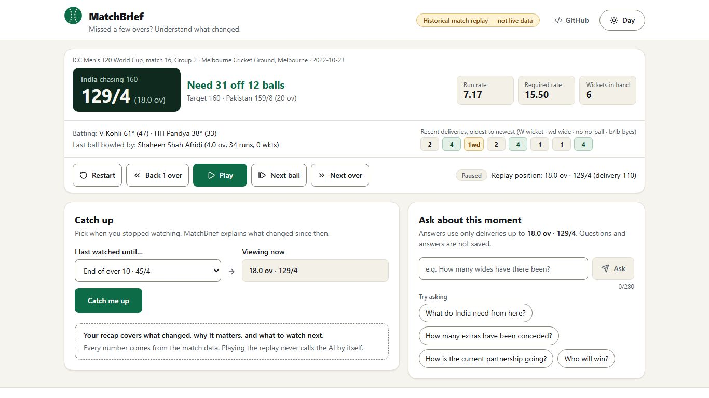
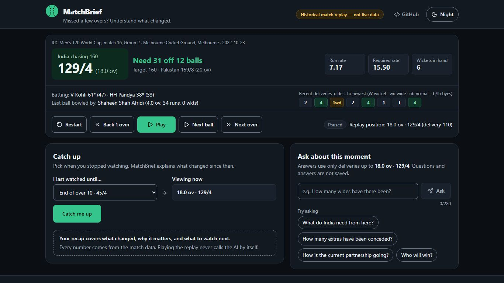
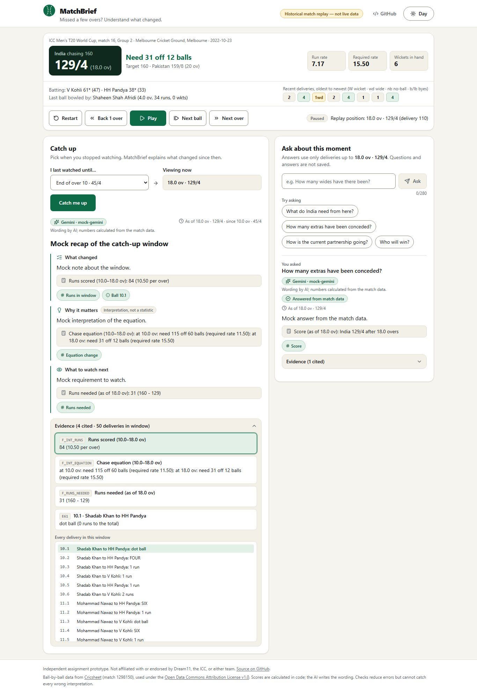
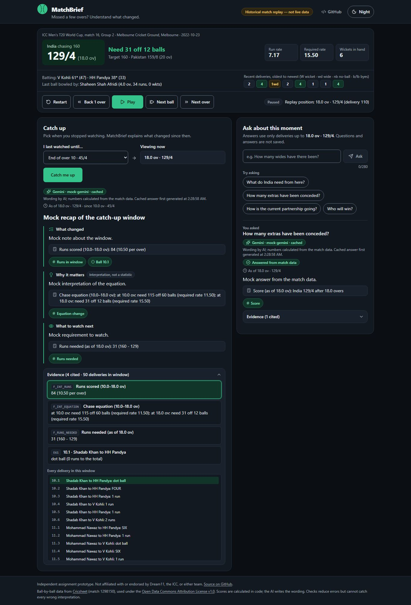
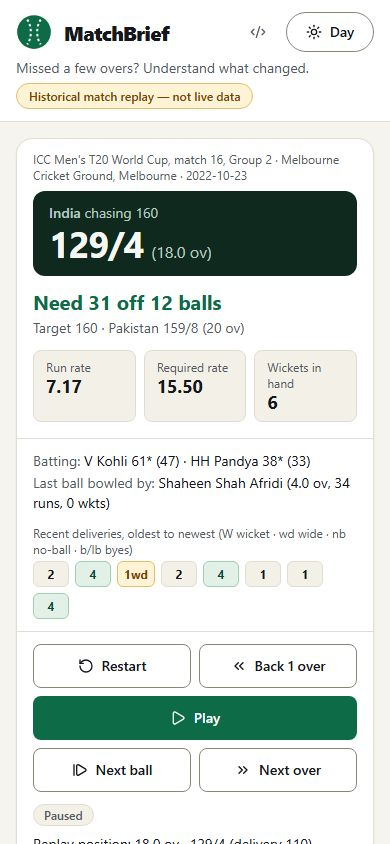
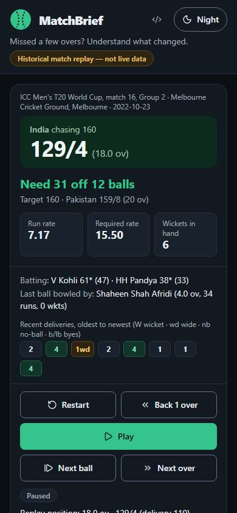
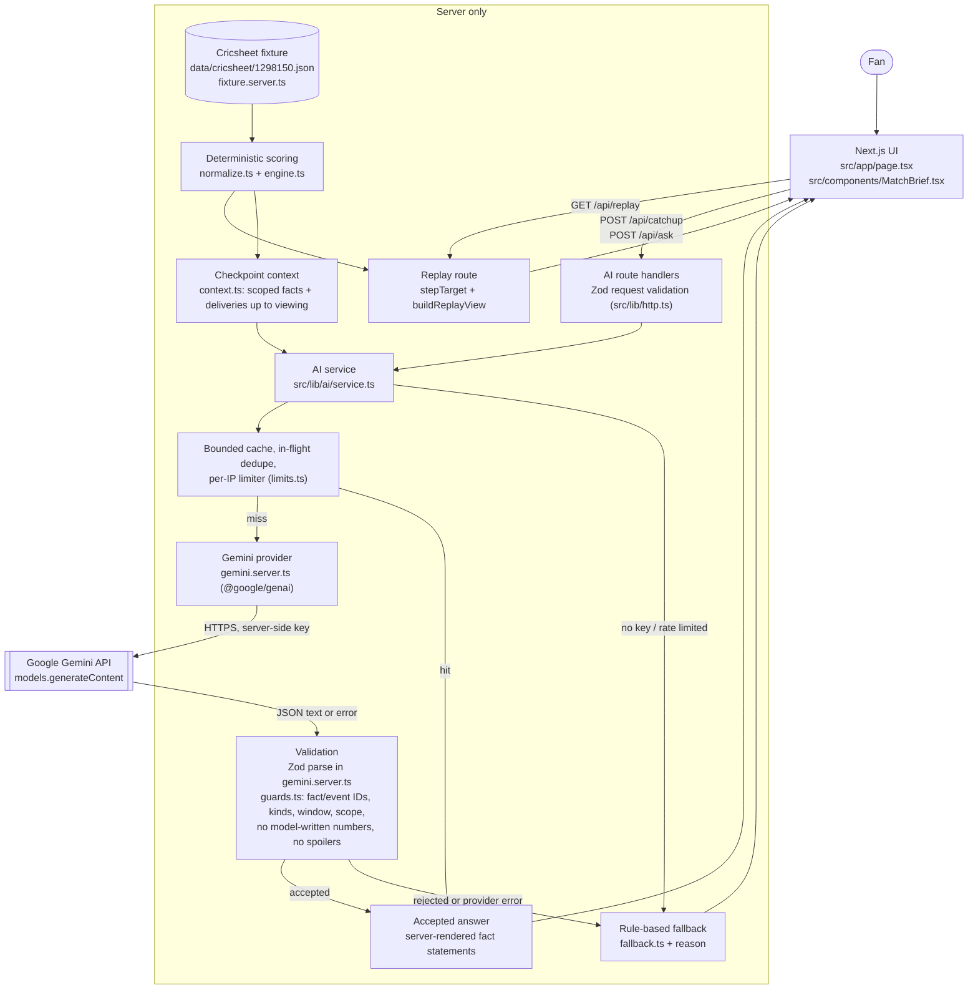
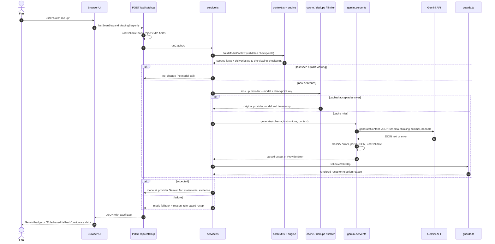

# MatchBrief

**Missed a few overs? Understand what changed.**

**Live demo:** [matchbrief.vercel.app](https://matchbrief.vercel.app/), a
historical replay powered by Google Gemini. It was checked on 2026-10-15; see
[verification status](#current-verification-status-2026-10-15).

Cricket fans step away during a T20 chase and come back to a different
scoreboard. Scrolling commentary to work out what happened takes longer than
the overs they missed. With MatchBrief, the fan says *"I last watched until
the end of over 10"* and gets a short, evidence-linked explanation of what
changed, why it matters, and what to watch next. They can then ask questions
about the current moment.

> **This is a historical match replay, not live data.** MatchBrief replays
> India's chase of 160 against Pakistan (ICC Men's T20 World Cup 2022, MCG)
> from Cricsheet ball-by-ball data. It is an independent assignment prototype
> for the Dream11 Forward Deployed Engineer Intern role. It is not a Dream11
> product, and it is not affiliated with or endorsed by Dream11, the ICC, or
> either team.

## Features

- **Replay controls:** Play/Pause, Next ball, Next over, Back 1 over, and
  Restart. Playback never calls the AI.
- **"I last watched until…" and "Catch me up":** three cards, *What changed*,
  *Why it matters* (marked as interpretation) and *What to watch next*.
- **Evidence chips:** each claim links to the delivery or calculation behind
  it. An expandable panel lists every delivery in the window.
- **Questions about this moment:** answers use only the deliveries up to the
  replay position. When the data can't answer (injuries, why a no-ball was
  called…), MatchBrief says so.
- **Numbers come from code, not the model:**
  - Gemini writes words only.
  - The server renders every number from calculated facts, each labelled with
    the checkpoint it describes, e.g. *"Runs needed (as of 18.0 ov): 31 (160 -
    129)"*.
- **Honest degradation:** any AI failure shows **"Rule-based fallback"** with
  a reason. The `Gemini · <model>` badge appears only on validated output.
- **Safe with time:** when the replay moves forward, answers keep their "as
  of" label. When it rewinds, they are cleared.
- **Day and night themes:**
  - The app follows the device setting on a first visit.
  - One click switches between day and night, and the choice is remembered.
  - Switching never resets the replay or makes a request.

## Revisions

| Version | Where | What |
| --- | --- | --- |
| Submitted version | `main` at `6c0f1b9`, deployed to production on 2026-10-15 | The app as submitted for the assignment |
| UI refresh | branch `feat/matchbrief-ui-refresh` (pull request, reviewed before release) | New page layout, day/night themes, and polished catch-up, question and evidence states. Presentation only: cricket logic, the Gemini integration and the API contracts are unchanged. |

## Demo walkthrough

1. Open the app. The scoreboard shows **129/4 after 18 overs, need 31 off 12**.
2. Leave "I last watched until…" on **End of over 10 · 45/4** and press
   **Catch me up**.
3. Click an evidence chip. The panel highlights the cited fact or delivery.
4. Ask **"How many extras have been conceded?"** The answer comes with the
   fact line "Extras conceded by Pakistan (as of 18.0 ov): 5 (wides 4, …)".
5. Ask **"Is Hardik Pandya injured?"** The answer is *Not in the match data*.

The full script is in [`docs/DEMO.md`](docs/DEMO.md).

## Screenshots (UI refresh)

These are real captures of the production build, made with `npm run
screenshots`. The AI responses are **mocked**, so the badge shows the model
as `mock-gemini`.

| Day | Night |
| --- | --- |
|  |  |
|  |  |
|  |  |


## High-level design



## Gemini request sequence



`POST /api/ask` follows the same path, using `runAsk` and `validateAnswer`.

## Trust boundaries and factual grounding

- **The browser is untrusted.** It sends only checkpoint numbers and a
  question of at most 280 characters. A score, model, token limit, "facts" or
  any other extra field is rejected with a 400.
- **The full fixture stays on the server.** That includes Cricsheet's
  `outcome` and `player_of_match`, which are never copied. The browser and the
  model only receive data from deliveries up to the viewing checkpoint, and
  tests scan for leaks.
- **The model is not the authority for statistics.**
  - `src/lib/cricket/engine.ts` computes runs, wickets, legal balls, overs,
    the target, runs needed, balls left, run rates, intervals and figures.
  - Gemini selects fact IDs and deliveries (`{id, kind}`) and writes short
    notes.
  - The guards reject output that:
    - uses unknown or future IDs;
    - gives a delivery the wrong kind;
    - cites "what changed" deliveries from outside the window;
    - bases "watch next" on facts from an old checkpoint;
    - contains any number written by the model;
    - hints at the result before the chase ends ("eventually", "chased
      down"…).
- **The fan's question is untrusted text.** It is fenced as data in the
  prompt. Answers come only from the bundled match context, with no tools,
  search or browsing.
- **Limits.** The guards remove whole classes of errors, but they **cannot
  prove** free-text interpretation is correct. An invented reason for a
  no-ball, for example, contains no numbers or result words. Gemini may also
  know this famous match's result from training data. See
  [`docs/DECISIONS.md`](docs/DECISIONS.md) §1 and §8.

## Tech stack

| Area | Choices |
| --- | --- |
| App | Next.js 16 (App Router, route handlers), React 19, TypeScript 5.9, Tailwind CSS 4 (semantic colour tokens), `next-themes` (day/night), `lucide-react` icons |
| AI | Google Gemini via the official `@google/genai` SDK (`models.generateContent`), default model `gemini-3.5-flash-lite`, structured JSON output |
| Validation | Zod 4 for request bodies and model output, plus deterministic guards |
| Tests | Vitest 5, Playwright 1.64 |
| Data | Cricsheet JSON, bundled into the server build |

Project layout:

```
data/cricsheet/     match file, manifest (sha256, pinned mirrors), NOTICE (license, provenance)
src/lib/cricket/    pure normalization + scoring engine (no server, no AI)
src/lib/match/      server-only fixture loader; client-safe replay view
src/lib/ai/         context, prompts, guards, fallback, cache/limiter, Gemini provider, service
src/app/api/        replay, catchup, ask route handlers
src/components/     the single-page UI
evals/cases.ts      evaluation cases (offline + live)
tests/              unit, e2e (Gemini mock), live + live-browser (real Gemini, opt-in)
docs/               DECISIONS, VERIFICATION, DEMO, SUBMISSION
```

## Run locally

You need Node.js 22 or newer.

```bash
git clone https://github.com/vijayshreepathak/match-brief.git
cd match-brief
npm install
cp .env.example .env.local     # add GEMINI_API_KEY; without it the app runs in labelled fallback mode
npm run dev                    # http://localhost:3000
```

| Variable | Required | Purpose |
| --- | --- | --- |
| `GEMINI_API_KEY` | For AI mode | Create one in [Google AI Studio](https://aistudio.google.com/apikey). Read on the server only; never give it a `NEXT_PUBLIC_` prefix. |
| `GEMINI_MODEL` | No | Default `gemini-3.5-flash-lite`. |
| `GEMINI_THINKING_LEVEL` | No | `minimal` (recommended), `low`, `medium` or `high`. Sent only if the model supports that level. |
| `MATCHBRIEF_AI_RATE_LIMIT` | No | AI calls per IP per 10 minutes, per server instance. Default 30. |

The app reads only `GEMINI_API_KEY` for the key. It ignores `GOOGLE_API_KEY`
and any old `OPENAI_*` variables. `GEMINI_BASE_URL` exists only for the test
mock; leave it unset.

## Tests and verification

```bash
npm run lint && npm run typecheck
npm test                   # unit tests (Vitest): no network, no key, no paid calls
npm run test:e2e           # production build + Playwright against a local Gemini mock and a no-key server
npm run screenshots        # after a build: review screenshots (mocked AI) into docs/screenshots/
npm run verify:ai:smoke    # opt-in, REAL Gemini: 2 calls (one catch-up, one factual question)
npm run verify:ai          # opt-in, REAL Gemini: smoke first, then the rest only if smoke passes
npm run verify:ai:browser  # opt-in, REAL Gemini through the browser UI
```

The real-Gemini commands read `.env.local` and use the production service and
guards. They run each case once, space calls 4.5 s apart to stay within
free-tier limits, and write reports to `reports/` (git-ignored).

## Current verification status (2026-10-15)

- **Mocked checks:** lint, typecheck, 222 unit tests and 23 Playwright e2e
  tests pass.
- **UI refresh** (branch `feat/matchbrief-ui-refresh`): all 23 original e2e
  tests still pass with no selector changes. 15 new tests cover:
  - themes: the device default, one-click switching, persistence and no
    wrong-theme flash;
  - no state loss and no requests when the theme changes;
  - evidence focus in night mode;
  - loading, error and retry states;
  - no horizontal overflow at 390 px and 320 px;
  - no console or hydration errors.

  A real-Gemini browser check of the new UI also passed: an accepted catch-up
  and an accepted question. See [`docs/VERIFICATION.md`](docs/VERIFICATION.md).
- **Real Gemini** (`gemini-3.5-flash-lite`, thinking `minimal`):
  - **Smoke test passed.** A genuine catch-up and a genuine factual question
    were both accepted.
  - **Full suite: 9 of 11 checks passed.**
    - One catch-up was rejected because Gemini wrote "four wickets". The fan
      saw a labelled fallback.
    - Asked "who won?" before the chase ended, Gemini gave an honest answer
      ("the result is not known at this checkpoint"), but tagged it
      *answered* rather than *declined*.
  - **Browser check passed:** the Gemini badge, evidence chips, an extras
    answer, and an honest "not in the data" answer.
  - [`docs/VERIFICATION.md`](docs/VERIFICATION.md) has the details, including
    the earlier failing runs and the fixes they led to.
- **Live deployment** ([matchbrief.vercel.app](https://matchbrief.vercel.app/)),
  checked 2026-10-15:
  - The site is public: HTTP 200 with no Vercel login. It loads at phone width
    without horizontal scrolling, and the replay controls work.
  - A live catch-up and a live extras question both returned accepted Gemini
    answers, with fact lines rendered by the server.
  - These first requests took 10.0 s and 6.5 s, slower than locally, probably
    because the serverless functions were starting up.
  - The deployed commit (`7a094dc`) matches `main` at the time of the check.

## Deploy to Vercel

1. **Get a Gemini key** from a **dedicated Google Cloud project**. The free
   tier has per-minute and per-day limits. If you enable billing, set a
   budget.
2. **Import the project.** In Vercel, choose **Add New → Project**, import
   this repository, and keep the **Next.js** preset. The app uses the default
   Node.js runtime; `package.json` requires Node 22 or newer.
3. **Set the variables** under **Settings → Environment Variables**
   (Production):
   - `GEMINI_API_KEY`
   - `GEMINI_MODEL=gemini-3.5-flash-lite`
   - `GEMINI_THINKING_LEVEL=minimal`
   - optional: `MATCHBRIEF_AI_RATE_LIMIT`

   Don't set `GEMINI_BASE_URL`. Redeploy after any change to these.
4. **Add a rate-limit rule.** In **Vercel Firewall → Rate Limiting**, target
   `POST /api/catchup` and `POST /api/ask` only. Leave `/api/replay`
   unthrottled so the replay controls keep working.
5. **Check public access** in an **incognito window** and on a **phone**:
   - If you see a Vercel login page, adjust **Deployment Protection**.
   - Confirm that **Catch me up** shows `Gemini · gemini-3.5-flash-lite`.

## Security and known limitations

- **Secrets:**
  - The key is used only in `src/lib/ai/gemini.server.ts`, which is marked
    `server-only`.
  - A build scan found no key, Gemini endpoint or SDK code in the client
    bundles.
  - `.env.local` is git-ignored.
- **Errors:** users see only a fallback reason. Logs record the HTTP status,
  RPC status and quota ID, never provider message bodies or keys.
- **Rate limiting:** the cache and rate limiter are process-local, not a
  distributed limit, and a shared link can exhaust the free tier. Rely on the
  Vercel and Google Cloud controls above.
- **Scope:** one match only. The fixture validator rejects rules the
  prototype doesn't implement (DLS, Super Overs, penalty runs).
- **Dev-only advisory:** `npm audit` reports GHSA-vfj7-8cjw-p6xm (`braces`)
  through `eslint-config-next`. It affects lint tooling only, and no fix has
  been published. `npm audit --omit=dev` reports 0. See
  [`docs/DECISIONS.md`](docs/DECISIONS.md) §17.
- **Data use:** Google's pricing page says free-tier data may be used to
  improve its products.
- **Live feed:** a live version would replace the bundled file with an
  authorized, append-only feed adapter that maps events into the same
  `Delivery` shape. It would push updates to the browser, and it would need to
  implement the rules rejected here. AI calls would stay user-triggered.

## Documentation

- [`docs/DECISIONS.md`](docs/DECISIONS.md): design decisions and trade-offs
- [`docs/VERIFICATION.md`](docs/VERIFICATION.md): commands run and their
  actual results
- [`docs/DEMO.md`](docs/DEMO.md): demo script
- [`docs/SUBMISSION.md`](docs/SUBMISSION.md): assignment note and
  pre-submission checklist
- [`evals/cases.ts`](evals/cases.ts): evaluation cases
- [`.env.example`](.env.example): configuration template

## Data provenance and attribution

Ball-by-ball data from [Cricsheet](https://cricsheet.org/) (match `1298150`),
used under the
[Open Data Commons Attribution License v1.0](https://opendatacommons.org/licenses/by/1-0/).

Cricsheet blocks scripted downloads, so the bundled file comes from five
public GitHub mirrors. The copies are byte-identical, and each one is pinned
to a commit. The calculated scorecard matches a published scorecard.
[`data/cricsheet/NOTICE.md`](data/cricsheet/NOTICE.md) and
[`manifest.json`](data/cricsheet/manifest.json) record the full checksum, the
mirror commits, and every runtime transformation.
